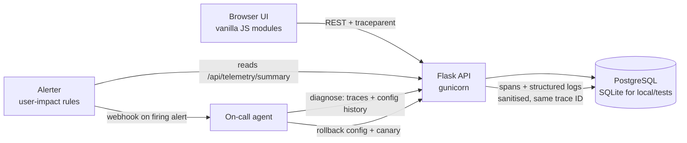

# Predictive Maintenance Hub

> Turn raw machine sensor readings into a prioritised maintenance queue, and keep that pipeline healthy with
> user-impact alerts and an **on-call agent that repairs bad configuration pushes by itself**.

Built for the [AI Dev Tools Zoomcamp](https://github.com/DataTalksClub/ai-dev-tools-zoomcamp) final project:
one application taken from specification to production, built by a team of AI agents following a written process.

| | |
|---|---|
| **Live demo (dev)** | _add your URL after deploying, see [docs/deployment.md](docs/deployment.md)_ |
| **API contract** | [`openapi.yaml`](openapi.yaml) |
| **Task tracker** | GitHub Issues / Project of this repository ([how it is used](docs/process/tracker.md)) |
| **Run everything** | `docker compose up --build` &rarr; http://localhost:8000 |

## 1. The problem

Maintenance teams in plants collect vibration, temperature and pressure readings from pumps, motors, compressors and fans.
Today those readings sit in spreadsheets or SCADA exports. Nobody looks at them until a machine fails, and then the
repair is unplanned, expensive and unsafe. Teams need three things:

1. **Know which machine is drifting towards failure *now*** - a risk level per machine, not a wall of numbers.
2. **Have the follow-up created automatically** - a work order for the machines that need an inspection, without duplicates.
3. **Trust the pipeline** - if recording readings breaks (for example after a bad configuration change), people must be
   alerted on *user impact* and the system should recover quickly.

## 2. What the system does

| Capability | Behaviour |
|---|---|
| Register machines | `POST /api/machines` with a unique code such as `PUMP-001`, a name and a type. |
| Record a reading (**key user journey**) | `POST /api/readings` with temperature, vibration and pressure. The reading is validated, scored 0-100 and stored. |
| Risk scoring | Level `low` / `medium` / `high` / `critical` from transparent thresholds. Model `v2` adds an anomaly bonus when a value is a statistical outlier for that machine ([details](docs/architecture.md#risk-model)). It is a prioritisation heuristic, **not** a calibrated failure probability. |
| Automatic work orders | A `high` or `critical` reading opens one work order (`P2` / `P1`). If the machine already has an open one, no duplicate is created. |
| Work-order workflow | `open` &rarr; `in_progress` &rarr; `done`, with an assignee. Invalid transitions return `409`. |
| Dashboard | Fleet overview, per-machine latest risk, forms to record readings and register machines, work-order actions. |
| Observability UI | `/observability`: journey health, traces, spans and structured logs correlated by trace ID, alerts and incidents. |
| Alerting | Rules on the key journey (error ratio, p95 latency), never CPU ([rules](ops/alerts/alert-rules.yaml)). |
| On-call agent | Wakes on an alert, finds the cause in traces, **rolls the config back**, verifies with canary requests, resolves the alert and writes an incident report ([design](docs/oncall-agent.md)). |

### Expected behaviour (examples)

```bash
# register a machine
curl -X POST localhost:8000/api/machines -H 'Content-Type: application/json' \
  -d '{"code":"PUMP-001","name":"Cooling pump","machine_type":"pump","location":"Plant A"}'

# a normal reading -> risk "low", no work order
curl -X POST localhost:8000/api/readings -H 'Content-Type: application/json' \
  -d '{"machine_code":"PUMP-001","temperature_c":45,"vibration_mm_s":1.2,"pressure_bar":6}'

# a degraded reading -> risk "critical" + work order P1 (response header X-Trace-Id links to the trace)
curl -i -X POST localhost:8000/api/readings -H 'Content-Type: application/json' \
  -d '{"machine_code":"PUMP-001","temperature_c":105,"vibration_mm_s":14,"pressure_bar":9.5}'
```

## 3. Architecture



Full description, data model and decisions: [docs/architecture.md](docs/architecture.md) and [docs/adr/](docs/adr).

| Layer | Technology | Why |
|---|---|---|
| Frontend | HTML + ES modules, no build step; `fetch` centralised in `frontend/src/api.js` | Zero toolchain, easy to review, unit-testable with `node --test` |
| Backend | Python 3.12, Flask, gunicorn | Small surface, explicit contract in `openapi.yaml` |
| Database | PostgreSQL 16 (compose, deployment); SQLite for local dev and fast tests | Same SQL runs on both, the CI runs the integration suite on both |
| Telemetry | In-app traces/spans/logs/metrics stored in the database, viewed at `/observability`, metrics at `/metrics` | Self-contained: one command gives the full observability loop, no extra infrastructure |
| Containers | Docker, Docker Compose (db, app, alerter, responder) | Single-command system |
| CI/CD | GitHub Actions, Render deploy hooks | PR tests, auto-deploy to dev, manual production deploy |

## 4. Quick start

**With Docker (everything, including database and on-call agent)**

```bash
docker compose up --build
# app + UI:       http://localhost:8000
# observability:  http://localhost:8000/observability
```

**Without Docker (SQLite, demo data)**

```bash
make install   # pip install -r requirements-dev.txt
make dev       # http://localhost:8000
```

**Tests - one command for all of them**

```bash
make test      # = python -m pytest  +  node --test (frontend)
```

| Suite | Where | Command |
|---|---|---|
| Unit (risk model, validation, telemetry, DB layer, alert rules) | `backend/tests/unit`, `oncall/tests/test_rules_unit.py` | `make test-unit` |
| Integration (API + real DB, OpenAPI contract, observability, alert &rarr; agent end to end) | `backend/tests/integration`, `oncall/tests/test_oncall_e2e.py` | `make test-integration` |
| Frontend (API client, form validation, formatting) | `frontend/tests` | `make test-frontend` |
| PostgreSQL | same integration suite | `TEST_DATABASE_URL=postgresql://... python -m pytest -m integration` |

## 5. Try the incident loop (alerting + on-call agent)

```bash
docker compose up --build -d
make demo        # healthy traffic
make incident    # pushes a bad config, sends traffic, waits for the agent, prints the incident report
```

What happens: the unvalidated config makes every reading fail (`500`) &rarr; the alerter sees the error ratio above 5 %
&rarr; it fires `ingest_reading_error_rate` and wakes the agent &rarr; the agent reads the failing traces, sees
`unknown risk model`, rolls `risk_model` back to the last verified value, confirms with canary readings, resolves the alert
and records an incident. Watch it live at `/observability`.

## 6. Observability, alerting, on-call agent

* **Key journey** `POST /api/readings`: root span plus child spans (`risk.score`, `db.insert_reading`, `workorder.create`),
  structured JSON logs and metrics, all sharing one **trace ID** (`X-Trace-Id` / W3C `traceparent` response header).
* **No customer data or credentials** in telemetry: keys such as tokens, passwords, e-mails and assignee names and
  values that look like e-mails or bearer tokens are redacted before storage ([test](backend/tests/integration/test_observability.py)).
* **Viewable** at `/observability` (UI) and `/metrics` (Prometheus text).
* **Alerts** are about user impact: error ratio and p95 latency of the key journey.
* **On-call agent** has one write permission (config rollback), a dry-run mode, and escalates whatever it cannot attribute
  ([guardrails](docs/oncall-agent.md#guardrails)).

## 7. CI/CD and deployment

* `ci.yml`: unit + integration tests on SQLite, integration on PostgreSQL, frontend tests, compose smoke test. Runs on every PR.
* `deploy-dev.yml`: on merge to `main`, CI passes &rarr; automatic deploy to **dev** &rarr; smoke test.
* `deploy-prod.yml`: **manual** (`workflow_dispatch`) with a required-reviewer `production` environment, smoke test, and the
  same workflow with an older ref is the **rollback**.
* Step by step: [docs/deployment.md](docs/deployment.md).

## 8. How this was built (AI-assisted workflow)

The project was specified first ([product-spec.md](product-spec.md)), broken into issues with acceptance criteria
([docs/tracker](docs/tracker)), and built by a defined agent team ([docs/agent-team.md](docs/agent-team.md)) following
[docs/process/](docs/process). Context for agents lives in [AGENTS.md](AGENTS.md), which points to modular docs.
The test suite, the OpenAPI contract test and the incident drill are the verification loop that keeps agent output honest.

## 9. Repository map

```
README.md  product-spec.md  AGENTS.md  openapi.yaml  docker-compose.yml  Dockerfile  Makefile  render.yaml
backend/    Flask API, risk model, telemetry, DB layer, tests (unit + integration)
frontend/   dashboard + observability UI, api client, tests
oncall/     alert rules engine, alerter (trigger), responder (agent), end-to-end tests
ops/alerts/ alert rules            scripts/   smoke test, traffic and incident simulators
docs/       architecture, process, agent team, runbooks, ADRs, tracker, deployment
.github/    CI, deploy-dev, deploy-prod, issue and PR templates
```

## 10. Limitations (honest list)

* The risk model is a heuristic for prioritising inspections, not a trained model.
* Telemetry is stored in the app database with a 24 h retention: good for a demo and small fleets; at scale you would
  export OpenTelemetry to a dedicated backend (see [ADR-003](docs/adr/003-builtin-telemetry.md)).
* There is no end-user login: the UI is meant for an internal network. Admin and agent endpoints use a bearer token.
* The on-call agent is runbook-driven (deterministic) rather than an LLM, on purpose ([ADR-004](docs/adr/004-runbook-agent.md)).
