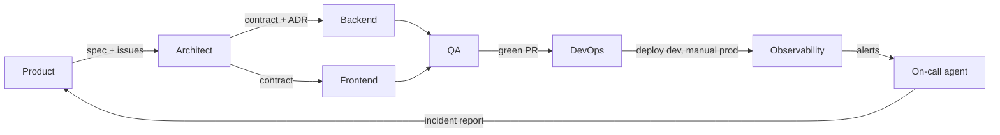

# Agent team

The project is built and operated by a small team of specialised agents. Each has a **role card** in
[`agents/roles/`](../agents/roles) that is loaded as its instructions. Humans (the project owner) approve scope and merges.

| Agent | Responsibility | Owns | Must not |
|---|---|---|---|
| **Product agent** | Turns goals into [product-spec.md](../product-spec.md) and issues with acceptance criteria | spec, tracker | write production code |
| **Architect agent** | Decides structure and contracts; writes ADRs and `openapi.yaml` first | `openapi.yaml`, `docs/adr` | change behaviour without updating the contract |
| **Backend agent** | Implements API, services, risk model, DB layer | `backend/app` | skip tests; log sensitive data |
| **Frontend agent** | Implements UI against the contract | `frontend/` | call the API outside `api.js`; use `innerHTML` |
| **QA agent** | Writes unit/integration/contract/e2e tests; blocks merges that lack them | `*/tests` | weaken tests to pass |
| **DevOps agent** | Docker, Compose, CI/CD, deployment, rollback | `Dockerfile`, `docker-compose.yml`, `.github`, `render.yaml` | commit secrets |
| **Observability agent** | Instrumentation, dashboards, alert rules, sanitisation | `backend/app/telemetry.py`, `ops/alerts`, `/observability` | send customer data to telemetry |
| **On-call agent** (runtime) | Responds to alerts in production | `oncall/responder.py` | any write other than `config_rollback` |

## How they work together

**Process** (full detail in [docs/process/workflow.md](process/workflow.md)):

1. Product agent writes/updates the spec and opens an issue with acceptance criteria.
2. Architect agent updates `openapi.yaml` (and an ADR if a decision is made) in the issue's branch.
3. Backend and Frontend agents implement in parallel against the contract; each opens a PR that closes the issue.
4. QA agent reviews: tests present, contract test green, no weakened assertions.
5. DevOps agent merges when CI is green; the dev deploy is automatic; production is a manual, approved step.
6. Observability agent checks the journey is visible in `/observability` and no sensitive data leaks.
7. At runtime the On-call agent handles alerts; its incident reports feed new issues.

## Hand-off contract

Every hand-off is an issue comment or PR description containing: what changed, how it was verified (commands + results),
what is left. An agent that cannot verify its work says so instead of claiming success.
